  
  <h3>Hi, I'm Clara! ☕</h3>
  
I'm a full-stack developer currently working on cool stuff.

  <h3>🌼 About me</h3>
  
I began my studies in 2020, when I first encountered a programming language. I have developed web platforms, desktop applications, interactive interfaces, and many other cool things! I am interested in front-end applications and anything else that will increase my curiosity about technology.

  <h3>🏙️ Contributions</h3>
  

    
    
  

  <h3>💌 Contact me</h3>
  <ul>
    <li><b>Email:</b> developer.clara@outlook.com</li>
    <li><b>Discord:</b> @star_fire.</li>
  </ul>

